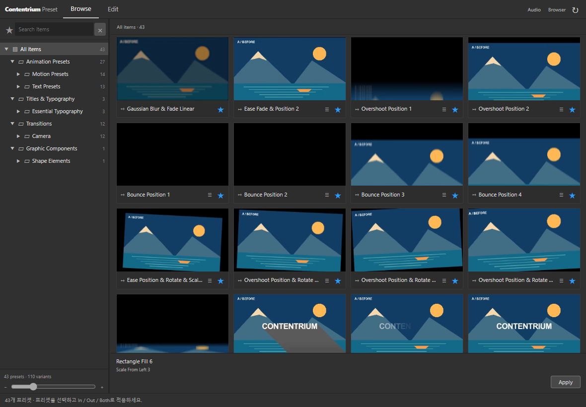

# Contentrium Preset

After Effects에서 사용하는 프리셋 패널입니다. 43개 프리셋·110개 변형과 Contentrium Grid 애니메이션 폰트를 탐색하고 레이어에 적용·편집할 수 있습니다. 개인 프리셋 저장, 타임라인 IN·OUT 조절, 설정 복사·초기화와 보조 도구를 제공합니다. 검증 환경은 Windows 11, After Effects 2026(26.5)입니다.

| 다운로드 | 설치 방식 |
| --- | --- |
| [설치 버전 · Setup.exe](https://github.com/contentriumkorea/contentrium-preset/releases/latest/download/Setup.exe) | 최신 버전을 다운로드하고 전체 설치 |
| [포터블·오프라인 · Portable.zip](https://github.com/contentriumkorea/contentrium-preset/releases/latest/download/Portable.zip) | 전체 패키지를 압축 해제하고 Install.cmd로 오프라인 설치 |

## 설치

1. 작업을 저장하고 After Effects를 닫습니다.
2. [최신 배포](https://github.com/contentriumkorea/contentrium-preset/releases/latest)의 `Setup.exe`를 실행합니다.
3. **설치**를 누릅니다. 최신 패키지 다운로드, 확인, 설치가 자동으로 진행됩니다.
4. After Effects를 다시 열고 **창 → 확장 → Contentrium Preset**에서 패널을 엽니다.

관리자 권한은 필요하지 않습니다. 현재 사용자 계정에 설치되며, Windows 설정의 **앱 → 설치된 앱**에서 제거할 수 있습니다. 시작 메뉴의 **Contentrium Preset → 사용 안내**에서도 안내를 볼 수 있습니다.

## 업데이트

작업을 저장하고 After Effects를 닫은 뒤 `Setup.exe`를 다시 실행하고 **설치**를 누릅니다. 최신 버전으로 업데이트되며, 기존 개인 즐겨찾기는 유지됩니다. 업데이트에 실패하면 이전 설치를 복구합니다.

## 포터블·오프라인 패키지

`Setup.exe`는 설치 버튼을 누르면 최신 버전을 자동으로 다운로드하고 설치합니다. `Portable.zip`에는 오프라인 설치에 필요한 패널과 설치 프로그램이 모두 포함되어 있습니다.

`Portable.zip`을 모두 압축 해제하고 `Install.cmd`를 실행합니다. 포함된 설치 프로그램에서 **설치**를 누르면 인터넷 연결 없이 사용자 CEP 폴더 등록, 프로그램 설치, Windows 앱 등록까지 진행됩니다. 압축 파일 안에서 바로 실행하지 마세요.

이 제품은 After Effects 안에서 사용하는 CEP 확장 패널입니다. 포터블 패키지도 호스트 등록과 After Effects가 필요하며, 독립 실행형 편집 앱으로 실행되지는 않습니다.

## 사용

1.2.0부터 사용자 라이브러리의 **폴더 추가**는 패널 안에 폴더 경로를 붙여넣는 방식입니다. 파일 탐색기 주소 표시줄에서 경로를 복사하고, **다음**에서 미리보기 저장 위치를 선택한 뒤 **추가**를 누릅니다.

임의 AEP의 자동 미리보기와 단일 네이티브 효과 컨트롤러는 이번 버전에서 활성화하지 않습니다. 지원 범위와 실제 검사 결과는 [검증 기록](docs/verification.md)을 참고하세요.

**Browse**에서 카테고리·검색·즐겨찾기로 프리셋을 고릅니다. 카드를 선택하면 카드 안에 변형 목록이 펼쳐집니다. **View all at once**로 모든 변형을 별도 카드로 볼 수 있고, **Back**으로 돌아옵니다. 선택한 변형을 **In / Out / Both** 또는 **Apply**로 적용하고 **Edit**에서 레이어의 컨트롤을 조정합니다.

미리보기는 프리셋 종류에 맞는 피사체를 사용합니다. 개체 애니메이션은 투명 로고 PNG, 텍스트·타이틀은 배경 이미지 없는 글자, 장면 전환은 보라·청록과 코럴·골드의 서로 다른 A/B 장면으로 구분합니다. After Effects에서 렌더한 클립이 포함된 항목은 해당 클립을 재생합니다. 미리보기는 프리셋의 동작 예시이며, 선택 레이어의 실시간 렌더 기능은 아닙니다.

개인 효과음은 설치 패키지와 별도의 사용자 오디오 라이브러리에 등록할 수 있습니다. 업데이트·제거 시 이 폴더는 유지됩니다. [오디오 등록 방법](docs/user-guide.md#개인-오디오-라이브러리)을 참고하세요.

[자세한 사용 안내](docs/user-guide.md)

타이틀의 기본 글꼴은 Montserrat ExtraBold·Black·Bold입니다. 글꼴 파일은 포함하지 않으며, [타이틀별 글꼴 안내](docs/user-guide.md#타이틀-기본-글꼴)에서 실제 이름과 변경 방법을 확인할 수 있습니다.



## 개발과 검증

런타임은 별도 패키지 설치 없이 After Effects의 CEP 패널로 실행됩니다. 소스 확인용 명령은 `npm test`, `npm run verify`입니다. 설치 프로그램 소스는 `installer`, 배포 패키징 스크립트는 `packaging`에 있습니다.

개발·검증 명령은 소스 저장소를 내려받은 프로젝트 루트에서 실행합니다.

Windows PowerShell에서 `npm ci`, `npm test`, `npm run verify`를 실행한 뒤 `./packaging/build-release.ps1 -Version 1.2.0`으로 설치 파일과 포터블 패키지를 생성합니다. 제품·CEP·카탈로그 버전은 모두 배포 버전과 같아야 합니다.

[검증 결과와 지원 범위](docs/verification.md) · [MIT 라이선스](LICENSE)

## 설치 파일 확인

`release-manifest.json`에는 `Portable.zip`의 파일 크기와 SHA-256이 포함됩니다. 설치 프로그램은 제품 저장소의 HTTPS 배포 파일을 확인한 뒤 설치하며, 다른 CEP 확장은 유지합니다. 업데이트 실패 시 기존 설치를 복구합니다.

설치 프로그램은 Microsoft .NET Framework가 포함된 Windows에서 실행됩니다.

## 명령줄 설치

`Setup.exe --silent`는 창을 띄우지 않고 최신 버전을 다운로드해 같은 전체 설치 과정을 진행합니다. 오프라인 패키지는 `Setup.exe --silent --offline-directory "압축 해제한 폴더"`, 제거는 설치된 `Uninstall.exe --silent --uninstall`을 사용합니다. After Effects는 먼저 닫아야 하며, 강제로 종료하지 않습니다. 종료 코드 0은 성공, 1은 오류입니다. 진행 내용은 stdout, 오류는 stderr로 UTF-8 출력합니다.

PowerShell에서는 설치가 끝날 때까지 기다리고 종료 코드를 확인하세요.

```powershell
$install = Start-Process -FilePath .\Setup.exe -ArgumentList '--silent' -Wait -PassThru -WindowStyle Hidden -RedirectStandardOutput .\setup.log -RedirectStandardError .\setup-error.log
$install.ExitCode
```
