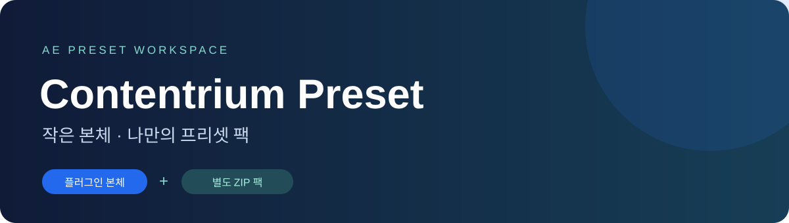
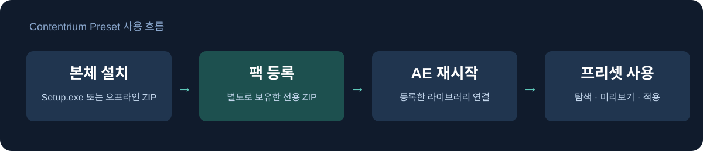

<p align="center"></p>
<h1 align="center">Contentrium Preset</h1>
<p align="center"><strong>본체는 가볍게, 프리셋은 따로.</strong><br>After Effects에서 프리셋을 탐색하고 적용·편집하는 패널입니다.</p>
<p align="center"><a href="https://github.com/contentriumkorea/contentrium-preset/releases/latest"></a>  <a href="LICENSE"></a></p>
<p align="center"><a href="#빠르게-시작하기">설치하기</a> · <a href="https://github.com/contentriumkorea/contentrium-preset/releases/latest">다운로드</a> · <a href="#사용-모습">사용 모습</a> · <a href="docs/user-guide.md">상세 안내</a></p>

---

## 빠르게 시작하기

**Windows와 After Effects가 필요합니다. 본체에는 프리셋 팩이 포함되지 않습니다.**

<p align="center"><a href="https://github.com/contentriumkorea/contentrium-preset/releases/latest/download/Setup.exe"></a> <a href="https://github.com/contentriumkorea/contentrium-preset/releases/latest/download/Portable.zip"></a></p>

작업을 저장하고 AE를 닫은 뒤 **Setup.exe → 설치**를 누르세요. 설치기가 최신 공개 버전을 내려받아 설치합니다. 이후 **창 → 확장 → Contentrium Preset**에서 패널을 엽니다.

[상세 설치 및 업데이트 안내 →](docs/user-guide.md)

## 세 가지 작업을 한곳에서

| 01 · 프리셋 탐색 | 02 · 적용과 편집 | 03 · 팩 별도 관리 |
| :--- | :--- | :--- |
| **검색과 미리보기로 선택** | **레이어에 맞춰 조정** | **본체 업데이트는 가볍게** |
| 등록한 팩의 분류·검색·즐겨찾기로 항목을 찾습니다. | 지원되는 변형을 적용하고 설정을 조정합니다. | ZIP 팩을 등록하고 본체와 독립적으로 보관합니다. |

## 사용 모습

<p align="center"></p>

**플러그인과 프리셋 팩을 분리해서 관리합니다.**

위 그림은 사용 흐름도입니다. 실제 패널 화면을 재현한 이미지는 아닙니다. 별도로 보유한 전용 팩이 있어야 프리셋을 사용할 수 있습니다.

<details><summary><strong>추가 예시 보기</strong></summary>

본체를 업데이트할 때는 Setup.exe만 다시 실행합니다. 기존 사용자 팩과 즐겨찾기는 유지됩니다. 팩을 등록할 때는 ZIP의 파일 확인과 압축 해제가 끝난 뒤 AE를 다시 엽니다.

</details>

## 설치와 배포 파일

| 방식 | 사용 방법 |
| :--- | :--- |
| **설치 버전 · Setup.exe** | 약 55KB. 최신 정식 본체를 다운로드하고 설치합니다. |
| **포터블·오프라인 · Portable.zip** | 약 5.9MB. 압축을 모두 풀고 Install.cmd로 AE에 등록합니다. |
| **프리셋 팩** | 본체에 포함하지 않으며 이 저장소에서 배포하지 않습니다. 별도로 보유한 팩을 등록합니다. |

이 제품은 AE 안에서 사용하는 확장 패널입니다. 포터블 패키지도 AE 등록이 필요하며 독립 실행형 편집 앱으로 실행되지 않습니다.

## 이렇게 사용하세요

```text
프리셋 팩 ZIP 등록 → ZIP 선택 → 등록 완료 → AE 재시작
Browse에서 탐색 → 지원되는 프리셋 적용 → Edit에서 조정
```

## 적용 범위와 제한

현재는 한 개의 전체 라이브러리 팩을 활성화합니다. 새 팩은 활성 라이브러리를 교체합니다. 팩에 표시되는 모든 변형이 적용 가능한 것은 아니며 검증된 적용 경로가 있는 변형만 활성화됩니다. 임의 AEP 자동 미리보기와 단일 네이티브 효과 컨트롤러는 활성화하지 않습니다.

<details><summary><strong>상세 안내와 검증 범위</strong></summary>

[사용 안내](docs/user-guide.md)와 [검증 범위](docs/verification.md)를 확인하세요. 격리 설치·팩 등록과 개발 회귀 검사를 마쳤으며, 새 ZIP 등록 기능의 실제 AE 설치본 전환 시험은 별도입니다.

</details>

<details><summary><strong>English overview</strong></summary>

Contentrium Preset is an After Effects panel with a lightweight core and separately managed preset packs. Download Setup.exe for online installation or Portable.zip for offline host registration. Preset packs are not included or distributed by this repository. Import a compatible pack you already own and restart After Effects. Only supported variants are enabled.

</details>

---

<p align="center"><strong>콘텐츠리움</strong><br><a href="LICENSE">MIT · 플러그인 본체</a> · <a href="https://github.com/contentriumkorea/contentrium-preset/releases/latest">Latest version</a></p>
<sub>프리셋 팩의 사용 조건과 권리는 각 팩의 제공 정보를 따릅니다.</sub>
<p align="center"><a href="https://contentrium.com/"></a></p>
